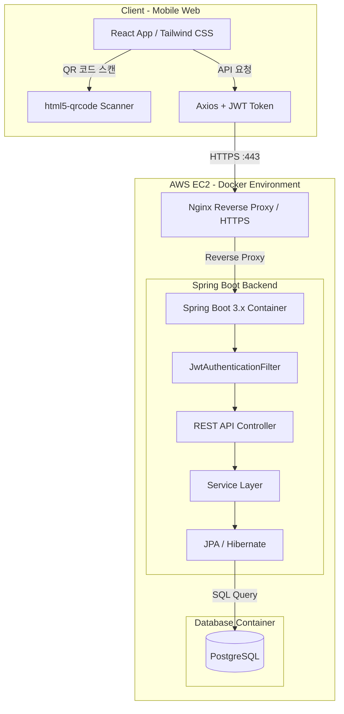

# 📦 QR 기반 공용 기자재 예약·반납 시스템
### QR Equipment Reservation System

> QR 코드를 활용하여 학과 공용 기자재의 대여 및 반납을 간편하게 처리하고, 기자재 상태와 대여 이력을 실시간으로 관리하는 모바일 웹 플랫폼입니다.

---

## 📌 1. 프로젝트 개요 (Project Overview)

### 프로젝트 소개

학과 공용 기자재의 기존 수기 대여·반납 방식을 개선하기 위해 개발한 QR 기반 모바일 웹 서비스입니다.

사용자는 스마트폰 카메라로 기자재에 부착된 QR 코드를 스캔하여 간편하게 대여 및 반납할 수 있으며, 관리자는 기자재 등록부터 전체 대여 현황 및 연체 관리까지 통합적으로 관리할 수 있습니다.

### 기본 정보

| 항목 | 내용 |
|:---|:---|
| 프로젝트명 | QR 기반 공용 기자재 예약·반납 시스템 |
| 영문명 | QR Equipment Reservation System |
| 개발 기간 | 12주 |
| 프로젝트 유형 | 풀스택 웹 프로젝트 |
| 주요 사용자 | 학생(USER), 관리자(ADMIN) |
| 핵심 기능 | QR 스캔, 기자재 대여·반납, 실시간 상태 관리 |
| 배포 환경 | Docker, AWS EC2, Nginx |

### 프로젝트 목표

- 수기 대여·반납 방식의 디지털 전환
- QR 코드 기반의 간편한 기자재 대여 및 반납
- 기자재 상태 및 대여 이력의 실시간 관리
- 중복 대여 방지를 통한 데이터 정합성 확보
- 관리자 중심의 기자재 관리 업무 효율화

### 사용자별 주요 기능

| 일반 사용자 (USER) | 관리자 (ADMIN) |
|:---|:---|
| QR 코드 스캔 | 기자재 등록 및 수정 |
| 기자재 대여 및 반납 | 전체 대여 현황 조회 |
| 본인 대여 내역 조회 | 연체 및 반납 상태 관리 |
| 기자재 상태 확인 | 기자재 관리 |

---

## 🛠 2. 기술 스택 (Tech Stack)

| 구분 | 기술 | 활용 목적 |
|:---|:---|:---|
| Backend | Java 17, Spring Boot 3.x | REST API 및 비즈니스 로직 구현 |
| ORM | Spring Data JPA, Hibernate | 데이터베이스 연동 및 객체 매핑 |
| Security | Spring Security, JWT | 사용자 인증 및 권한 관리 |
| API Documentation | Swagger | API 문서화 및 테스트 |
| Frontend | React, JavaScript (ES6+) | 사용자 인터페이스 구현 |
| Styling | Tailwind CSS | 모바일 퍼스트 반응형 UI |
| HTTP Client | Axios | 프론트엔드와 백엔드 API 통신 |
| QR Scanner | html5-qrcode | 모바일 카메라 기반 QR 코드 인식 |
| Database | PostgreSQL | 데이터 저장 및 대여 이력 관리 |
| DevOps | Docker, Docker Compose | 컨테이너 기반 실행 환경 구성 |
| Deployment | AWS EC2, Nginx | 서버 배포 및 리버스 프록시 |
| SSL | Certbot (Let's Encrypt) | HTTPS 보안 인증서 적용 |

---

## 🗺 3. 시스템 아키텍처 (System Architecture)

### 전체 시스템 구조



### 요청 처리 흐름

1. 사용자가 모바일 웹에 접속하여 로그인합니다.
2. JWT 토큰을 발급받아 인증 정보를 관리합니다.
3. 모바일 카메라로 기자재에 부착된 QR 코드를 스캔합니다.
4. Axios를 통해 기자재 식별 정보를 백엔드 API로 전달합니다.
5. JWT 인증 필터에서 사용자 인증 및 권한을 검증합니다.
6. Service 계층에서 기자재의 대여 가능 여부와 현재 상태를 확인합니다.
7. JPA를 통해 PostgreSQL의 대여 및 반납 정보를 갱신합니다.
8. 처리 결과를 프론트엔드에 반환하여 최신 기자재 상태를 화면에 반영합니다.

---

## 🚀 4. 핵심 기능 (Core Features)

### 4-1. QR 코드 기반 대여 및 반납

- `html5-qrcode` 라이브러리를 활용한 모바일 카메라 QR 코드 인식
- QR 코드와 기자재 정보 연동
- QR 스캔 결과에 따른 대여 및 반납 처리
- 모바일 환경에 최적화된 반응형 UI 제공

### 4-2. 동시성 제어 및 중복 대여 방지

- 프론트엔드 스로틀링을 통한 연속 스캔 방지
- 백엔드 트랜잭션 기반 데이터 정합성 관리
- 대여 가능 상태 검증
- 중복 대여 요청 시 `409 Conflict` 반환

### 4-3. JWT 기반 인증 및 권한 관리

- Spring Security와 JWT를 활용한 사용자 인증
- 일반 사용자(`ROLE_USER`)와 관리자(`ROLE_ADMIN`) 권한 분리
- JWT 인증 필터를 통한 API 요청 검증
- 관리자 전용 API 접근 제어

### 4-4. 글로벌 예외 처리 및 유효성 검증

- `@RestControllerAdvice` 기반 글로벌 예외 처리
- 커스텀 예외 클래스를 통한 비즈니스 예외 관리
- 요청 데이터 유효성 검증
- HTTP 상태 코드 기반 표준 에러 응답 구성

---

## 💡 5. 주요 트러블슈팅 (Troubleshooting)

### 5-1. 모바일 레이아웃 및 뷰포트 최적화

**문제**

- 초기 데스크톱 중심 레이아웃으로 인해 모바일 화면에서 QR 스캔 영역이 깨지는 현상 발생

**해결**

- Mobile-First 디자인 규칙 적용
- QR 스캔 영역을 1:1 비율로 재설계
- 화면 크기에 따른 반응형 레이아웃 적용

**결과**

- 다양한 모바일 기기에서 안정적인 QR 스캔 UI 구현

### 5-2. JPA 외래키 타입 불일치

**문제**

- `rentals` 테이블 생성 과정에서 기본키(PK)의 `BIGINT`와 외래키(FK)의 `INTEGER` 타입이 일치하지 않아 데이터베이스 오류 발생

**해결**

- 엔티티 및 데이터베이스 스키마의 ID 타입 확인
- PK와 FK의 데이터 타입을 `BIGINT`로 통일

**결과**

- 외래키 제약조건 정상 적용 및 테이블 간 관계 설정 완료

### 5-3. JWT 권한 인가 오류 (403 Forbidden)

**문제**

- 관리자 API 호출 시 인증은 정상적으로 수행되지만 권한 인가 과정에서 `403 Forbidden` 오류 발생

**해결**

- JWT 생성 시 사용자 권한 정보 확인
- Spring Security의 권한 규칙에 맞게 `ROLE_` 접두사 적용
- `ROLE_ADMIN` 기반 접근 제어 설정 수정

**결과**

- 관리자 권한 검증 및 관리자 전용 API 접근 정상화

### 5-4. 모바일 카메라 HTTPS 접근 문제

**문제**

- 모바일 브라우저에서 카메라 기능을 사용하기 위해 HTTPS 보안 환경 필요

**해결**

- AWS EC2에 Nginx Reverse Proxy 구성
- Let's Encrypt 기반 SSL 인증서 발급
- Certbot을 통한 HTTPS 적용 및 인증서 갱신 환경 구성

**결과**

- HTTPS 환경에서 모바일 카메라 접근 및 QR 코드 스캔 기능 구현

### 5-5. 데이터베이스 타임존 불일치

**문제**

- Docker 컨테이너의 기본 UTC 설정으로 대여 및 반납 시간에 시차 발생

**해결**

- Dockerfile에 `TZ=Asia/Seoul` 환경변수 설정
- 애플리케이션과 데이터베이스의 시간 처리 기준 통일
- 날짜 및 시간 데이터 저장과 조회 기준 점검

**결과**

- 한국 표준시(KST)를 기준으로 대여 및 반납 이력 관리

---

## 📁 6. 프로젝트 디렉토리 구조 (Directory Structure)

```text
QR_equipment-reservation-system/
│
├── backend/
│   ├── src/
│   │   └── main/
│   │       └── java/com/example/equipment/
│   │           ├── config/          # Security, Swagger 설정
│   │           ├── controller/      # REST API 엔드포인트
│   │           ├── dto/             # DTO 및 Validation
│   │           ├── entity/          # JPA 엔티티
│   │           ├── exception/       # 글로벌 예외 처리
│   │           ├── jwt/             # JWT 토큰 및 인증 필터
│   │           ├── repository/      # Spring Data JPA
│   │           ├── security/        # 인증 및 권한 관리
│   │           └── service/         # 비즈니스 로직
│   │
│   └── build.gradle
│
├── frontend/
│   ├── src/
│   │   ├── components/              # QR Scanner 및 공통 UI
│   │   ├── pages/                   # 메인, 대여 목록, 마이페이지
│   │   └── api/                     # Axios 및 인터셉터 설정
│   │
│   └── package.json
│
├── database/
│   └── schema.sql                   # PostgreSQL DDL
│
├── docs/
│   ├── requirements.md              # 요구사항 명세서
│   └── wireframe.md                 # 화면 흐름도 및 와이어프레임
│
├── docker-compose.yml
├── README.md
└── .gitignore
```

---

## ⚙️ 7. 실행 방법 (Getting Started)

### 7-1. 사전 요구사항

프로젝트 실행을 위해 다음 환경이 필요합니다.

- Java 17 이상
- Node.js 및 npm
- PostgreSQL
- Docker 및 Docker Compose

### 7-2. 저장소 클론

```bash
git clone https://github.com/kkimming/qr-equipment-system.git

cd qr-equipment-system
```

### 7-3. 백엔드 실행 (Spring Boot)

```bash
cd backend

./gradlew bootRun
```

### 7-4. 프론트엔드 실행 (React)

새 터미널을 열고 다음 명령어를 실행합니다.

```bash
cd frontend

npm install

npm run dev
```

### 7-5. Docker Compose 실행

프로젝트 루트 디렉토리에서 실행합니다.

```bash
docker-compose up --build -d
```

**컨테이너 상태 확인**

```bash
docker-compose ps
```

**컨테이너 로그 확인**

```bash
docker-compose logs -f
```

**컨테이너 종료**

```bash
docker-compose down
```

---

## 🔐 8. 보안 및 운영 (Security & Operations)

- JWT 기반 사용자 인증 및 권한별 API 접근 제어
- HTTPS를 통한 클라이언트와 서버 간 통신 암호화
- 관리자 전용 API 접근 권한 검증
- 환경변수를 활용한 데이터베이스 접속 정보 및 JWT 비밀키 관리
- Docker 기반 컨테이너 운영 환경 구성
- 대여 및 반납 이력의 데이터 정합성 유지

---

## 📈 9. 프로젝트 기대 효과 (Expected Outcomes)

| 구분 | 기대 효과 |
|---|---|
| 업무 효율성 | 수기 대여·반납 절차 간소화 |
| 사용자 편의성 | QR 코드 기반 간편한 기자재 이용 |
| 관리 효율성 | 기자재 상태 및 대여 현황 실시간 확인 |
| 데이터 관리 | 대여 및 반납 이력의 체계적인 관리 |
| 시스템 안정성 | 중복 대여 방지 및 데이터 정합성 확보 |

---

## 🔗 10. 프로젝트 저장소 (Repository)

**GitHub**

[QR Equipment Reservation System](https://github.com/kkimming/qr-equipment-system)

---

## ⭐ 마무리

QR Equipment Reservation System은 QR 코드 기반의 간편한 기자재 대여·반납과 실시간 상태 관리를 제공하는 모바일 웹 플랫폼입니다.

Spring Boot 기반의 백엔드 API 설계부터 React 프론트엔드 구현, PostgreSQL 데이터 관리, Docker 및 AWS EC2 배포까지 전체 개발 과정을 경험하는 것을 목표로 합니다.
